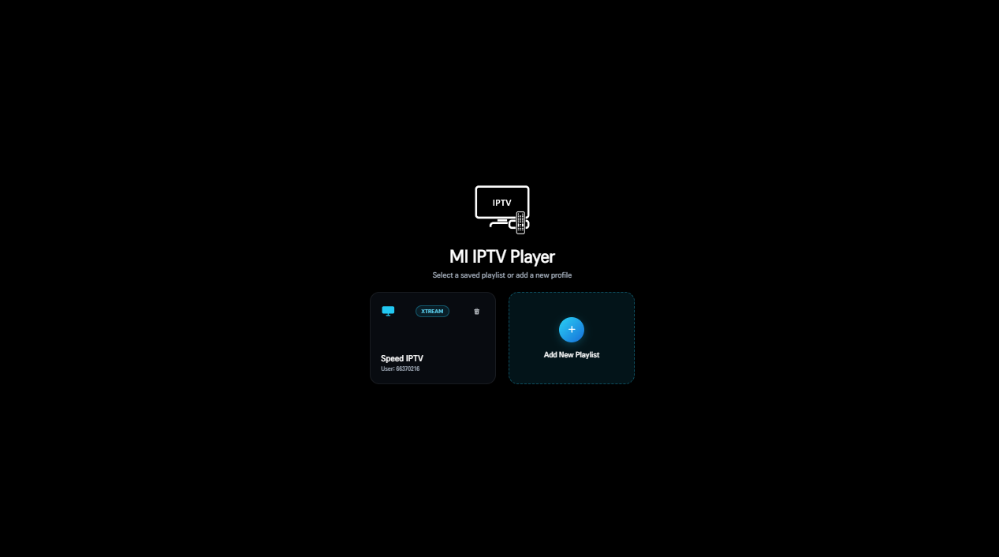
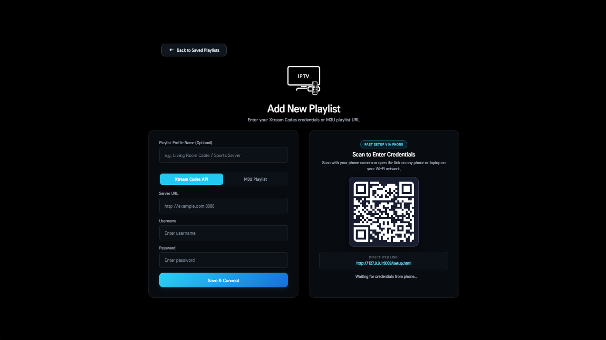
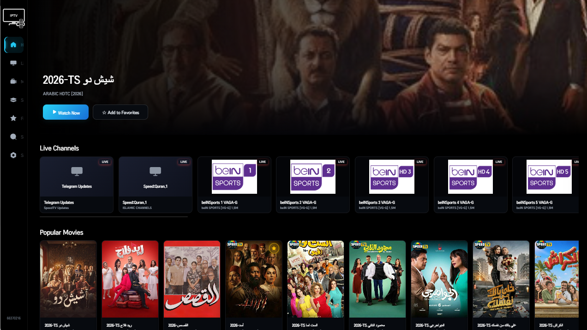
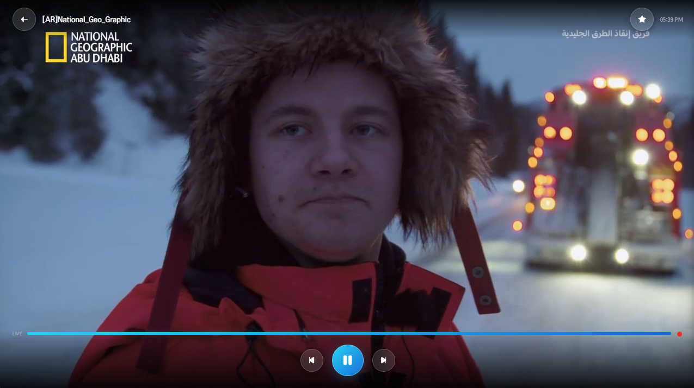

# MI IPTV Player

A modern, high-performance Smart TV & Desktop IPTV player designed for **10-foot viewing experiences**. Built with clean architecture, zero-dependency 2D spatial navigation, and hardware-accelerated streaming pipelines across **LG webOS TVs**, **Samsung Tizen TVs**, and **Windows Desktop PCs**.

Supports **Xtream Codes API** and **M3U / M3U8 playlists**, Live TV with side-drawer channel browsing, Movies (VOD), Series with multi-season episode navigation & auto-advance, smartphone QR code credential setup, and offline desktop downloads.

---

## Supported Platforms

| Platform | Target OS / Runtime | Output Package | Guide |
|---|---|---|---|
| **LG Smart TVs** | webOS 3.0 – 25+ (Chromium 38 – 108+) | `dist/com.miiptv.player_1.0.0_all.ipk` | [LG webOS Guide](docs/WEBOS.md) |
| **Samsung Smart TVs** | Tizen 2.4 – 8.0+ (Firmware v1510+) | `dist/MIIPTVPlayer.wgt` & USB `userwidget/` | [Samsung Tizen Guide](docs/TIZEN.md) |
| **Windows Desktop** | Windows 10 & 11 x64 (Electron) | `dist/windows/MI IPTV Player-win32-x64/` | [Windows Desktop Guide](docs/WINDOWS.md) |

---

## App Screenshots

| Saved Playlists & Profiles | Phone QR Code & Xtream / M3U Setup |
| :---: | :---: |
|  |  |

| 10-Foot Home Screen & Live / VOD Rows | Fullscreen Live TV & VOD Player OSD |
| :---: | :---: |
|  |  |

---

## Key Features Across All Platforms

- **Unified 10-Foot TV User Interface (`1920x1080` Canvas)**
  - Designed specifically for TV viewing distances with zero CSS `zoom` distortion, smooth focus rings, and responsive grid layouts.
  - **4 Built-in TV Themes**: *Midnight Signal (Default)*, *Graphite Amber*, *OLED Mint*, and *Daylight Slate*.
- **Multi-Stage Playback Pipeline with Automatic Fallbacks**
  - **LG webOS**: Native GStreamer hardware HLS/TS → `Hls.js` MSE → `mpegts.js` MSE → local proxy.
  - **Samsung Tizen**: Native HTML5 `<video>` + MSE → Samsung Hardware `webapis.avplay` (HEVC 4K, Dolby AC-3/E-AC-3 audio, raw MKV/TS).
  - **Windows Desktop**: GPU-accelerated Chromium media engine + offline local file playback (`file:///...`).
- **Fast Mobile Setup via QR Code**
  - Instant pairing: scan the on-screen QR code from your phone to input server URL, username, and password without typing via a TV remote.
- **Hardware Remote Control Protocol**
  - Seamless support for standard IR remotes, LG Magic Remote (cursor + scroll wheel), and Samsung Smart Remote.
  - LIFO Back button management: dismisses modals, channel drawers, and player overlays sequentially before exiting the app.
  - Dedicated `CH+ / CH-` buttons for rapid live channel switching and `+10s / -10s` seeking for movies/series.
- **Series Episode Management & 95% Auto-Advance**
  - Multi-season episode browser with watched episode tracking, adjacent episode calculation, and automatic next episode playback upon 95% completion.
- **Windows Offline Background Downloader**
  - Queue individual movies, series episodes, full seasons, or complete series to disk for offline viewing.
  - Supports pause, resume, parallel downloads, and automatic remuxing to universal MP4 (AAC 48kHz).

---

## Prerequisites & One-Click Setup

### Requirements
- **Node.js**: v18.0.0 or later (Node 20+ / 24+ recommended)
- **npm**: v9.0.0 or later
- **Python**: v3.10 or later *(optional, for local `server.py` and Graphify knowledge graph)*

### One-Click Setup Script
Run the automated setup script to install all Python dependencies from `requirements.txt`, install Node.js modules across all platform workspaces (`webos-build` and `windows`), and run the 16 characterization tests:

```cmd
install-dependencies.bat
```

Alternatively, install components manually:
```bash
# 1. Python dependencies
pip install -r requirements.txt

# 2. webOS & Tizen build tools (Babel, PostCSS, esbuild)
cd webos-build && npm install && cd ..

# 3. Windows Desktop Electron dependencies
cd windows && npm install && cd ..

# 4. Verify characterization tests
node --test tests/characterization.test.js
```

---

## Quick Start & Packaging Commands

### 1. LG webOS TV (`.ipk`)
Detailed instructions: [docs/WEBOS.md](docs/WEBOS.md)
```cmd
# Build the IPK package
package-webos.bat

# Install onto your LG TV over LAN
install-webos.bat <TV_IP_ADDRESS>
```

### 2. Samsung Tizen TV (`.wgt` & USB)
Detailed instructions: [docs/TIZEN.md](docs/TIZEN.md)
```cmd
# Build both LAN and USB packages
package-tizen.bat

# Option A: Copy dist/tizen-usb/userwidget to a FAT32 USB drive and plug into TV
# Option B: Install onto your Samsung TV over LAN
install-tizen.bat <TV_IP_ADDRESS>
```

### 3. Windows Desktop (`.exe`)
Detailed instructions: [docs/WINDOWS.md](docs/WINDOWS.md)
```cmd
# Package the portable Windows executable
package-windows.bat

# Launch the player
start "" "dist\windows\MI IPTV Player-win32-x64\MI IPTV Player.exe"
```

---

## Repository Structure

```text
├── IPTVPlayer/                  # Shared 10-foot UI Application Shell
│   ├── appinfo.json             # LG webOS application manifest
│   ├── index.html               # Main application DOM & screen layouts
│   ├── setup.html               # Mobile companion setup web page
│   ├── server.py                # Standalone Python HTTP test server
│   ├── icon.png / largeicon.png # Application icons
│   ├── css/                     # Modular 10-foot stylesheets
│   │   ├── theme.css            # Central design tokens & theme definitions
│   │   ├── base.css             # 1080p canvas, focus states & reset
│   │   ├── navigation.css       # Collapsible side navigation rail
│   │   ├── components.css       # Cards, modals, buttons & forms
│   │   ├── browse.css           # Category lists & virtualized grid layout
│   │   ├── series.css           # Series detail view & episode lists
│   │   ├── player.css           # Video player OSD, channel banner & HUD
│   │   └── downloads.css        # Desktop download manager UI
│   ├── js/
│   │   ├── app.js               # Application coordinator & routing
│   │   ├── core/                # SpatialNav, KeyHandler, BackStack, Storage, Theme, Platform
│   │   ├── services/            # PlaybackEngine, PlayerService, StreamResolver, Xtream, M3U
│   │   ├── components/          # Card, BrowseView, ChannelDrawer, PlayerOsd, DownloadManager
│   │   └── views/               # HomeView, SeriesDetailView, SearchView, SettingsView, LoginView
│   └── fonts/lineicons/         # Vector icon font assets
│
├── IPTVService/                 # LG webOS Node.js Companion Background Service
│   ├── service.js               # HTTP setup server on port 8089 & Luna bus handler
│   └── companionCore.js         # Shared ES5 companion server implementation
│
├── webos-build/                 # LG webOS Build Pipeline
│   └── build.mjs                # Babel ES5 transpiler & PostCSS fallback compiler
│
├── tizen-build/                 # Samsung Tizen Build Pipeline
│   ├── config.xml               # Samsung Tizen W3C widget manifest
│   └── build.mjs                # Tizen ES5 build & dual-target WGT packager (LAN + USB)
│
├── windows/                     # Windows Desktop Electron Engine
│   ├── main.js                  # Electron main process & IPC coordinator
│   ├── preload.js               # Secure context bridge API
│   ├── downloader.js            # Background HTTP streaming & queue manager
│   ├── downloadUtils.js         # Path resolver, sanitizer & MP4 remuxer
│   └── build.js                 # Electron packager & distribution builder
│
├── docs/                        # Platform Documentation
│   ├── WEBOS.md                 # LG webOS installation, pairing & debugging guide
│   ├── TIZEN.md                 # Samsung Tizen USB & LAN deployment guide
│   ├── WINDOWS.md               # Windows desktop setup, shortcuts & downloader guide
│   └── screenshots/             # Application UI screenshots
│
├── tests/                       # Automated Characterization & Unit Test Suite
│   └── characterization.test.js # 16 node:test platform & service assertions
│
├── dist/                        # Built Distribution Artifacts
│   ├── com.miiptv.player_1.0.0_all.ipk            # LG webOS TV package
│   ├── MIIPTVPlayer.wgt                           # Samsung Tizen LAN package
│   ├── tizen-usb/userwidget/MIIPTVPlayer.wgt      # Samsung Tizen USB flash drive package
│   └── windows/MI IPTV Player-win32-x64/          # Windows Desktop portable application
│
├── package.json                 # Workspace coordinator & npm build/test scripts
├── requirements.txt             # Python requirements (graphifyy, requests)
├── server.py                    # Standalone Python HTTP test server with CORS
├── install-dependencies.bat     # One-click installer for Python & Node dependencies
├── package-webos.bat            # Build & package LG webOS .ipk
├── install-webos.bat            # Install .ipk onto LG TV over LAN
├── package-tizen.bat            # Build & package Samsung Tizen .wgt (LAN + USB)
├── install-tizen.bat            # Install .wgt onto Samsung TV over LAN
├── install-tizen-emulator.bat   # Auto-sign and deploy to running Tizen Emulator
└── package-windows.bat          # Build & package Windows x64 .exe
```

---

## Running Characterization Tests

To run the built-in 16-test characterization suite covering all parsers, stream resolver strategies, watch progress, and platform adapters:

```bash
node --test tests/characterization.test.js
```

---

## License

This project is licensed under the Apache 2.0 License.
