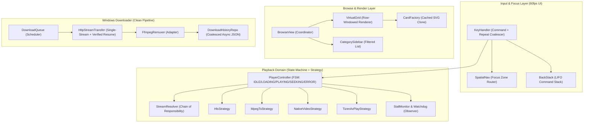

# MI IPTV Player — Feature Inventory, Commit History Analysis & SOLID Redesign Plan

> **Date**: 2026-11-21  
> **Repository**: `MI IPTV Player` (`f:\Workspace\IPTV`)  
> **Scope**: Full feature audit, 37-commit evolution & regression post-mortem, current codebase metrics, and a pragmatic **SOLID + Design Patterns + Clean Code** redesign plan focused on **60fps responsiveness, stream smoothness, and rock-solid feature reliability** across **LG webOS 3.x+**, **Samsung Tizen 2.4+**, and **Windows Desktop (Electron)**.

---

## 1. Complete App Feature Inventory

### 1.1 Multi-Platform Targets & Packaging
| Platform | Runtime Constraints | Build Pipeline | Output Artifact |
| :--- | :--- | :--- | :--- |
| **LG webOS TV (3.x – 25+)** | Chromium 38+ (ES5), Node 0.12 on-TV service (`IPTVService`), ~150–300 MB app RAM | `package-webos.bat` → `webos-build/build.mjs` (Babel ES5 + PostCSS CSS vars) + `ares-package` | `dist/com.miiptv.player_1.0.0_all.ipk` (~457 KB) |
| **Samsung Tizen TV (2.4+)** | WebKit/Chromium (ES5), hardware `webapis.avplay` fallback, no local Node service | `tizen-build/build.mjs` (Babel ES5 + CSS minify + WGT zip) | `dist/MIIPTVPlayer.wgt` (~451 KB) + USB zip |
| **Windows Desktop** | Electron v33 (Chromium 130, Node 20), local Express-less HTTP proxy, `ffmpeg` remux | `windows/build.js` (`@electron/packager` + portable zip) | `dist/windows/MI IPTV Player-win32-x64/MI IPTV Player.exe` + `.zip` |
| **Web / GitHub Pages** | Browser portal for phone QR pairing (`setup.html` + `pairingRelay.js`) | GitHub Actions Pages workflow | Static portal |

### 1.2 Core User-Facing Features
1. **Authentication & Multi-Profile Management (`loginView.js`, `storage.js`)**
   - Multiple saved profiles (Xtream Codes API & M3U Playlist URLs).
   - Profile create, switch, and delete (with modal confirmation).
   - **Phone QR Pairing**:
     - LAN companion server (`IPTVService/companionCore.js` + `tvServer.js`) for LG webOS & Windows.
     - End-to-end encrypted cloud pairing relay (`pairingRelay.js`) for Samsung Tizen / cross-network setup.
2. **Catalog Ingestion & Caching (`xtreamService.js`, `m3uParser.js`, `catalogStore.js`, `storage.js`)**
   - Xtream Codes API (`live`, `vod`, `series` + categories + series episode metadata) and M3U `#EXTINF` parsing.
   - IndexedDB catalog cache (`CatalogCache`) with TTL freshness to skip multi-second network fetches on restart.
   - Favorites system (`CatalogStore`) persisted per connection, toggleable via UI button or remote `F`/Yellow/Blue keys.
3. **10-Foot TV & Desktop Browsing UI (`homeView.js`, `browseView.js`, `seriesDetailView.js`, `searchView.js`, `settingsView.js`)**
   - **Home**: Continue Watching row, Favorites row, Recent Live/Movies/Series rails.
   - **Browse (Live TV, Movies, Series)**: Category sidebar with live search, selected category title badge in top header, Grid View (4-col Live / 5-col VOD) & Rows View toggle, row-windowed grid virtualization (`> 60` items), TV inactive-tab DOM reclamation.
   - **Series Detail**: Poster/plot header, season tabs, episode cards with watch progress bars, per-episode / per-season / full-series downloads (Desktop).
   - **Global Search**: Debounced async multi-pool search across Live, Movies, and Series (with `Ctrl+F` shortcut on Desktop).
   - **Settings & Themes**: 4 high-contrast 10-foot themes (`midnight-signal`, `graphite-amber`, `oled-mint`, `daylight-slate`), Autoplay Next Episode toggle, profile switching, Download folder & Universal TV Compatibility Mode (Desktop).
4. **Multi-Engine Video Playback (`playerService.js`, `playbackEngine.js`, `streamResolver.js`, `playerOsd.js`, `channelDrawer.js`, `watchProgressTracker.js`)**
   - **4 Playback Engines**: Hls.js MSE (`.m3u8`), mpegts.js MSE (`.ts` live/VOD), Native `<video>`, and Samsung Tizen `webapis.avplay` hardware decoder.
   - **Smart Candidate Resolution**: Offline-first local file priority (Desktop), local proxy wrapping for CORS/range support, and remembered preferred strategy per server.
   - **Resilience**: Candidate watchdog, stall monitor (buffer-gap jump + live in-place reload), HLS network/media recovery, live TS in-place reconnect, and `visibilitychange` suspend/restore.
   - **OSD & Controls**: 3-tier D-pad OSD navigation, interactive playbar scrubbing, Seek HUD, Channel Banner, In-Player Live Channel Drawer (with category pills & D-pad navigation), Watch Progress auto-resume modal, and automatic Next Episode playback.
5. **Windows Offline Download Manager (`windows/downloader.js`, `windows/downloadUtils.js`, `downloadStore.js`, `downloadManager.js`)**
   - Single-stream sequential HTTP downloader with verified `Content-Range` pause/resume and duplicate detection.
   - Optional **Universal TV Compatibility Mode** (`ffmpeg` auto-remux to MP4 + AAC 48kHz).
   - Queue management (active progress, pause/resume/cancel, completed history, delete file, open folder, custom save directory).
6. **10-Foot Navigation & Input (`spatialNav.js`, `keyHandler.js`, `backStack.js`, `platform.js`)**
   - Hardware remote support (LG webOS, Samsung Tizen, Android TV, Desktop keyboard/mouse, Magic Remote scroll wheel).
   - Strict hardware Volume pass-through to TV OS.
   - LIFO `BackStack` covering 7 UI states (modals, channel drawer, OSD, player, series detail, browse/search, exit).

---

## 2. Commit History Analysis (37 Commits: `d62bdeb` → `0c231fa`)

### 2.1 Evolution Timeline
| Phase | Dates | Key Commits | What Happened |
| :--- | :--- | :--- | :--- |
| **1. Foundation (webOS TV)** | Oct 31 | `d62bdeb` – `4474df5` | Initial 10-foot UI, `IPTVService`, Lineicons removed (`3.9 MB → 391 KB`), Impeccable TV design, QR server shutdown hardening, IndexedDB cache & lazy MSE (`8d7e87d`). |
| **2. Visual Polish & Windows Desktop** | Nov 1–3 | `2741966` – `d66a903` | 4 themes, 5-column VOD grid, Electron Windows `.exe` packaging (`app.asar` shrunk `223 MB → 1.3 MB` in `9a94857`), first resume-seek freeze fix (`5db728f`). |
| **3. Offline Downloader & Modularization** | Nov 6–7 | `05976fc` – `9caf3c5` | Background downloader, `ffmpeg` TV remux mode, offline-first playback, first clean-architecture pass extracting `EventBus`, `CatalogStore`, `BackStack`, `Platform`, `PlaybackEngine`, `StreamResolver`, `PlayerOsd`, `ChannelDrawer`, `DownloadStore`, `WatchProgressTracker`. |
| **4. Samsung Tizen & E2E Pairing** | Nov 9 | `189b4fb` – `153c991` | Tizen `.wgt`/USB build, `AVPlay` fallback, E2E encrypted QR pairing relay, sidebar focus-leak fix (`75c16c5`), second desktop resume-seek freeze fix (`153c991`). |
| **5. Resilience, Consolidation & Regressions** | Nov 12–21 | `6d39490` – `0c231fa` | IDM multi-segment downloader (`6d39490`) → corrupted mid-video gaps; `IntersectionObserver` + `no-referrer` (`d637f9a`) → broken posters; both fixed in `013a0f8`; consolidated helpers (`bcec299`); selected category header (`0c231fa`). |

### 2.2 Recurring Failure Patterns Revealed by Git History
1. **Playback & Resume-Seek State Bugs (3 separate fixes: `5db728f`, `153c991`, `013a0f8`)**
   - *Root Cause*: Playback lifecycle state (`_initialSeekPending`, `_initialSeekAttempted`, `_streamStarted`, `_avplayActive`, `_userPaused`, timers) is split between `PlayerService` and `PlaybackEngine` as loose mutable fields instead of an explicit **Finite State Machine** + **Engine Strategy** boundary.
2. **Control Lag & Focus Leaks (`4958d80`, `75c16c5`, and current lag report)**
   - *Root Cause*: `SpatialNav` grew into a 620-line imperative router mixing DOM queries, scroll mutations, side-nav hover state, and layout reads; CSS accumulated heavy multi-layer blurred shadows and lacked `contain: layout style paint`; `KeyHandler` lacked repeat-key coalescing.
3. **Aggressive Speculative Optimizations Breaking Real IPTV Servers (`6d39490` & `d637f9a` → reverted in `013a0f8`)**
   - *Root Cause*: IPTV providers are non-standard HTTP servers (they reject `no-referrer`, drop concurrent range connections, close live TS sockets arbitrarily). Any optimization that assumes textbook CDN behavior breaks real streams/downloads.
4. **Monolithic Growth in Hot Files**
   - Even after `9caf3c5`, the top 6 JS files still hold **5,025 lines** of tightly coupled logic:
     - `windows/downloader.js` — **1,418 lines** (52 Graphify edges, #1 God Node)
     - `IPTVPlayer/js/services/playbackEngine.js` — **969 lines**
     - `IPTVPlayer/js/services/playerService.js` — **768 lines**
     - `IPTVPlayer/js/components/downloadManager.js` — **737 lines**
     - `IPTVPlayer/js/views/browseView.js` — **643 lines**
     - `IPTVPlayer/js/core/spatialNav.js` — **620 lines**
     - `IPTVPlayer/js/app.js` — **593 lines**
   - Plus stale/duplicated artifacts: `IPTVService/companionCore.js` manually copied to `windows/companionCore.js`, and an obsolete 417-line `tizen-build/Debug/projects/tizen-build/build.mjs`.

---

## 3. SOLID & Clean Code Audit (Current Architecture vs Target)

| Principle | Current Violation | Concrete Redesign Fix |
| :--- | :--- | :--- |
| **S — Single Responsibility** | `Downloader` (1,418 LOC) owns queue, HTTP streaming, retry, ffmpeg remux, history JSON, disk checks, and IPC. `PlaybackEngine` (969 LOC) owns 4 engines + watchdogs + stall monitor. `BrowseView` (643 LOC) owns sidebar, search, virtual grid, rows, and DOM reclamation. | Split each into cohesive single-purpose modules (see §4). |
| **O — Open / Closed** | Adding or tuning a playback engine requires editing 8 `if (_avplayActive) ... else if (hls) ... else if (mpegts)` branches in `playbackEngine.js`. Adding a focus zone requires editing `SpatialNav.navigate()`. | **Strategy Pattern** for playback engines (`HlsStrategy`, `MpegTsStrategy`, `NativeVideoStrategy`, `TizenAvPlayStrategy`). **Focus Zone Registry** for `SpatialNav`. |
| **L — Liskov Substitution** | `AVPlay` mutates `_avplayCurrentTime` / `_avplayDuration` on `player` while HTML5 engines read `player.video.*`; callers branch on `_avplayActive`. | Every `PlaybackStrategy` implements the exact same contract: `load()`, `play()`, `pause()`, `seek(sec)`, `getTime()`, `getDuration()`, `isPaused()`, `suspend()`, `restore()`, `destroy()`. |
| **I — Interface Segregation** | `PlaybackEngine` reaches into 15+ private fields on `player` (`player._markCandidateSuccess`, `player._updateProgress`, `player.playerScreen`, `player._initialSeekPending`, etc.). | Pass a narrow **`PlaybackCallbacks`** object (`onReady`, `onPlaying`, `onTimeUpdate`, `onEnded`, `onFatalError`) + read-only `PlaybackRequest` into each strategy. |
| **D — Dependency Inversion** | Views and services directly reference global singletons (`window.IPTV.CatalogStore`, `window.IPTV.Storage`, `window.IPTV.Platform`). | Keep `window.IPTV` as the composition root (required for zero-bundler TV builds), but inject dependencies via constructor/`init(deps)` with defaults so every module is cleanly testable in isolation. |

---

## 4. Target Architecture & Design Patterns (Pragmatic, TV-Safe)

> **Karpathy Guideline Check (Simplicity First)**: No framework rewrite (React/Vue would add overhead on LG webOS 3.x Chromium 38), no speculative abstractions, and **zero** breaking changes to the proven ES5 Babel + PostCSS TV build pipeline. Every pattern below directly solves a recurring bug or latency bottleneck from §2.

### 4.1 Design Pattern Map (Only Where Earned)
1. **Strategy Pattern — Playback Engines (`IPTVPlayer/js/services/engines/`)**
   - Extract `HlsStrategy`, `MpegTsStrategy`, `NativeVideoStrategy`, and `TizenAvPlayStrategy` behind one uniform interface.
   - `PlaybackEngine` becomes a thin ~150-line orchestrator + `StallMonitor` / `Watchdog` owner.
   - *Payoff*: Eliminates all `_avplayActive` / `_hls*` / `_ts*` cross-engine leakage and makes adding/fixing an engine surgical.
2. **Finite State Machine (FSM) — `PlayerService` Lifecycle**
   - Explicit states: `IDLE → RESOLVING → LOADING → BUFFERING → PLAYING ⇄ PAUSED / SEEKING → RECOVERING → ERROR`.
   - Resume-seek (`initialSeekTime`) becomes a first-class `SEEKING` transition with a single timeout fallback to `0s`, permanently preventing the 3x-recurring black-screen resume bug.
3. **Focus Zone Strategy — `SpatialNav`**
   - Split the 620-line `SpatialNav.navigate()` into small, O(1) **Zone Handlers** (`SideNavZone`, `CategorySidebarZone`, `VirtualGridZone`, `HorizontalRailZone`, `SeriesDetailZone`, `CartesianFallbackZone`) + a dedicated `ScrollViewport` helper (`preventScroll: true` + single-pass scroll).
   - *Payoff*: Predictable < 1ms focus transitions on TV and Windows; zero accidental O(N) full-DOM scans.
4. **Component Composition — `BrowseView` → `VirtualGrid` + `CategorySidebar`**
   - Extract `VirtualGrid` (row-windowed DOM recycling + abort-on-detach images + focus-index restoration) and `CategorySidebar` (chunked mount + debounced filter) out of `BrowseView`.
   - *Payoff*: `BrowseView` drops from 643 lines to ~180 lines; `VirtualGrid` can also be reused if needed for large Search or Favorites views.
5. **Pipeline Decomposition — `windows/downloader.js`**
   - Split the 1,418-line monolith into 4 focused modules:
     - `DownloadQueue` (concurrency = 1–2, pause/resume/cancel state transitions, IPC event emission)
     - `HttpStreamTransfer` (sequential HTTP/HTTPS download, redirect handling, verified `Content-Range` resume, stall timeout)
     - `FfmpegRemuxer` (Universal TV MP4+AAC remux + progress parsing)
     - `DownloadHistoryRepo` (coalesced async JSON persistence + disk-existence check)
   - *Payoff*: Each module is ~200–300 lines, independently unit-testable without mocking all of Electron/HTTP/ffmpeg at once.
6. **Single Source of Truth — Build & Companion Code**
   - Delete stale `tizen-build/Debug/projects/tizen-build/build.mjs`.
   - Have `windows/build.js` (and `windows/main.js`) load `IPTVService/companionCore.js` directly (or auto-copy during build) so the two copies can never drift.

---

## 5. Phased Redesign Execution Plan (Goal-Driven & Reversible)

Each phase ships a working, tested, 3-platform-built app with **zero big-bang rewrite risk**:

| Phase | Scope | Key Files | Measurable Success Criteria |
| :--- | :--- | :--- | :--- |
| **Phase 0 (Done / In Working Tree)** | Immediate control responsiveness & stream smoothness fixes (repeat coalescing, `preventScroll`, O(1) grid edges, CSS `contain` + lightweight shadows, windowed grid, TV MSE caps, `TCP_NODELAY`, `res.on('close')`). | `keyHandler.js`, `spatialNav.js`, `browseView.js`, `playbackEngine.js`, `companionCore.js`, `css/*` | 36/36 characterization tests pass; all 3 builds pass; crisp D-pad & keyboard response. |
| **Phase 1: Playback Strategy & FSM** | Extract 4 `PlaybackStrategy` adapters + explicit `PlayerState` FSM; remove `_avplayActive` branches & loose private properties on `player`. | `playbackEngine.js`, `playerService.js`, `services/engines/*.js` | Every engine passes uniform contract tests; resume-seek FSM tested for success, timeout, and fallback-to-0; 0 leaked timers on rapid channel zapping. |
| **Phase 2: UI Navigation & Browse Decomposition** | Split `SpatialNav` into O(1) Focus Zones + `ScrollViewport`; extract `VirtualGrid` & `CategorySidebar` from `BrowseView`; pre-clone SVG templates in `Card`. | `spatialNav.js`, `browseView.js`, `card.js`, `virtualGrid.js`, `categorySidebar.js` | Focus move < 2ms on 5,000-item catalog; DOM cards capped ≤ 60; zero layout thrash on horizontal/vertical nav; TV tab reclamation preserves exact focus & scroll. |
| **Phase 3: Windows Downloader Pipeline** | Split `windows/downloader.js` (1,418 LOC) into `DownloadQueue`, `HttpStreamTransfer`, `FfmpegRemuxer`, `DownloadHistoryRepo`; keep single-stream verified `Content-Range` integrity. | `windows/downloader.js`, `windows/download/*.js`, `downloadManager.js` | Zero byte-range corruption; pause/resume/remux unit-tested per module; `downloader.js` facade < 250 lines. |
| **Phase 4: Cleanup & Composition Hygiene** | Remove stale `tizen-build/Debug/...`; eliminate manual `companionCore.js` duplication; split `components.css` (1,084 LOC) by component; inject dependencies via `init(deps)`. | `windows/main.js`, `windows/build.js`, `css/*`, `app.js` | Single source of truth for `companionCore.js`; all 3 platform builds (`webOS .ipk`, `Tizen .wgt`, `Windows .exe`) verified; Graphify updated. |

---

## 6. Key Design Decisions to Align On Before Phase 1

1. **Incremental Refactor vs. Bundler Migration**:
   - *Recommendation*: Keep the current zero-bundler `<script>` architecture + Babel ES5 TV builds (fast, proven on Chromium 38 / webOS 3.x, tiny ~450 KB TV packages). Only add a bundler if module count exceeds ~50 files.
2. **Phase 0 First**:
   - The current working tree already contains **Phase 0** (Batches A, B, C + the TV/Windows control responsiveness fixes, 36/36 tests passing). Should we **build + verify + commit Phase 0** as a clean baseline checkpoint before starting **Phase 1 (Playback Strategy & FSM)**?
3. **Priority Order**:
   - Do you want to execute **Phase 1 → Phase 2 → Phase 3 → Phase 4** in order, or prioritize **Phase 2 (UI/Navigation)** first for maximum immediate UI smoothness?
