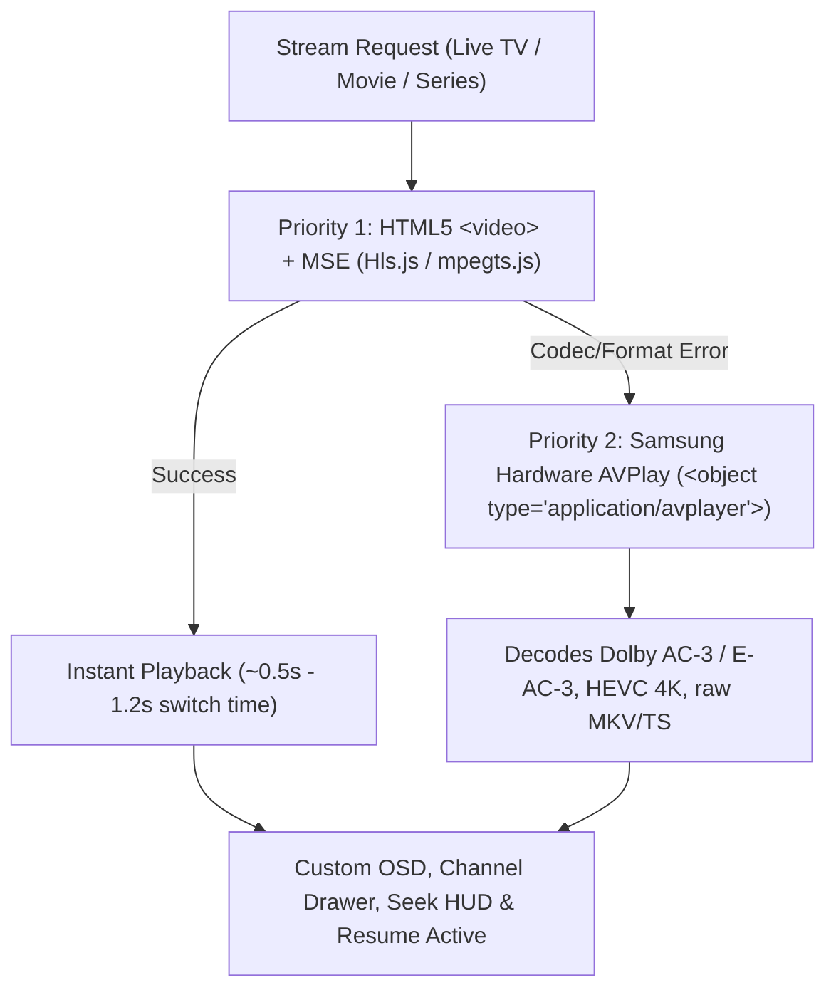

# Samsung Tizen TV Guide — MI IPTV Player

Complete guide for building, installing, and running MI IPTV Player on **Samsung Smart TVs running Tizen OS** (compatible with **Tizen 2.4, 3.0, 4.0, 5.0, 6.0, 7.0, and 8.0+**, including firmware **`v1510`**).

---

## 1. Samsung Tizen OS Compatibility

| Tizen OS Version | Model Years / Firmware | WebEngine Runtime | Playback & Architecture Features |
|---|---|---|---|
| **Tizen 2.4 / 3.0** | 2016 – 2017 (e.g. `v1510` / `T-KTM2DEUC`) | Chromium 47 | Strict Babel ES5 transpilation, CSS `var(--*)` static fallback pass, hardware `<video>` + MSE fallback, `webapis.avplay` fallback |
| **Tizen 4.0** | 2018 | Chromium 56 | Native Flexbox, HLS + MPEG-TS MSE streaming, Samsung TV Input Device API |
| **Tizen 5.0 / 5.5** | 2019 – 2020 | Chromium 63 – 69 | Full 10-foot UI, transparent video plane hole-punching, remote color keys |
| **Tizen 6.0 / 6.5** | 2021 – 2022 | Chromium 76 – 85 | Progressive rendering, low-latency live streaming, screensaver management |
| **Tizen 7.0 / 8.0+** | 2023 – 2025+ | Chromium 94 – 108+ | 4K UHD compositor auto-scaling, hardware video decoding |

---

## 2. Multi-Stage Playback Engine on Samsung Tizen

On Samsung TVs, MI IPTV Player uses an intelligent two-tier playback strategy:



1. **Primary (`<video>` + MSE)**: Fast channel switching (~0.5–1.2s) with native DOM events driving the OSD progress bar and continue-watching tracker.
2. **Fallback (`webapis.avplay`)**: If a stream uses codecs not supported by the HTML5 element (such as Dolby AC-3/E-AC-3 audio or raw `.ts`/`.mkv` containers), the player automatically hands off to Samsung's hardware `AVPlay` pipeline behind the transparent OSD.
3. **Identical UI & Controls**: All custom controls (channel drawer, progress bar, +10s/-10s HUD, Continue Watching modal) work identically in both modes.

---

## 3. Remote Control Key Mappings

| Samsung Remote Key | Key Code | App Action |
|---|---|---|
| **D-Pad (Up, Down, Left, Right)** | `38`, `40`, `37`, `39` | Spatial grid navigation across channels, categories, and settings |
| **OK / Enter** | `13` | Select / activate focused item; toggle OSD |
| **Return / Back** | `10009` | LIFO back stack: closes player, drawer, or modal before exiting app |
| **Channel Up / Channel Down** | `427`, `428` | Direct next / previous channel switch during playback |
| **Play / Pause / PlayPause** | `415`, `19`, `10252` | Hardware transport control |
| **Fast Forward / Rewind** | `417`, `412` | Jump forward / backward 10 seconds |
| **Channel List / Guide** | `10190`, `458` | Open / close live channel drawer during playback |
| **Red / Green / Yellow / Blue** | `403`–`406` | Yellow/Blue toggles Favorite status |

---

## 4. Packaging the Tizen App (`.wgt`)

Run the automated Tizen build script:
```cmd
package-tizen.bat
```

This creates **two output packages** in `dist/`:
1. **`dist/MIIPTVPlayer.wgt`** (~441 KB) — for LAN / SDB installation.
2. **`dist/tizen-usb/userwidget/MIIPTVPlayer.wgt`** — for USB flash drive installation.

---

## 5. Installation Methods

### Method 1: USB Flash Drive (Easiest — No PC Tools Needed)
1. Format a USB flash drive as **FAT32**.
2. Copy the `userwidget` folder from `dist/tizen-usb/userwidget` to the **root** of the USB drive:
   ```text
   E:\userwidget\MIIPTVPlayer.wgt
   ```
3. Plug the USB flash drive into your Samsung TV's USB port.
4. The TV will display a notification saying **"Installing user widget"** and add **MI IPTV Player** to your Smart Hub / Apps bar.
5. Once installed, you can unplug the USB drive.

---

### Method 2: Over Wi-Fi / LAN via Developer Mode

#### Step 1: Enable Developer Mode on the Samsung TV
1. Turn on your Samsung Smart TV and press the **Home** button on the remote.
2. Navigate to **Apps**.
3. On your remote control, press the number keys **`1` `2` `3` `4` `5`** in sequence.
4. The **Developer Mode configuration popup** will appear:
   - Toggle **Developer Mode** to **ON**.
   - In **Host PC IP**, enter your computer's local IP address (e.g. `192.168.1.50`).
   - Click **OK**.
5. Restart your Samsung TV (hold the Power button on the remote for 3 seconds until the Samsung logo appears, or unplug power for 10 seconds).

#### Step 2: Install Using the Automated Script
Make sure your PC and TV are on the same local network, then run:
```cmd
install-tizen.bat <TV_IP_ADDRESS>
```
*Example:*
```cmd
install-tizen.bat 192.168.1.120
```

#### Step 3: Manual CLI Commands (Tizen Studio CLI / SDB)
If installing manually with SDB:
```bash
# 1. Connect to TV
sdb connect <TV_IP>:26101

# 2. Check connected devices
sdb devices

# 3. Install WGT package
tizen install -n dist/MIIPTVPlayer.wgt -t <DEVICE_NAME>
# OR with direct sdb:
sdb install dist/MIIPTVPlayer.wgt

# 4. Launch app
tizen run -p MIIPTVPlay.MIIPTVPlayer
# OR with sdb:
sdb shell 0 was_execute MIIPTVPlay.MIIPTVPlayer
```

